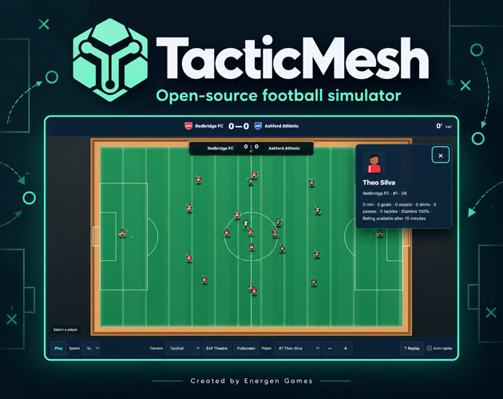
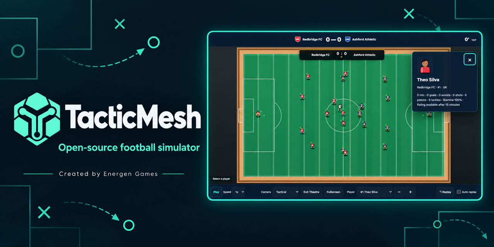

# Energen Games branding deployment

Verified 11 October 2026 at 08:42:12 GMT−4.

## Public identity

- YouTube: [Energen Games, @energengames](https://www.youtube.com/@energengames). Stable channel ID: `UCCUzsipDONs6c0MgT6JgMRg`. Supplied emblem, matching ImageGen banner, About text, play/source links and existing Redwood playlist link saved.
- itch.io: [Energen Games](https://noddy703.itch.io), with the existing [TacticMesh page](https://noddy703.itch.io/tacticmesh), new creator credit, emblem, channel link and revised cover. Discussion board remains enabled.
- GitHub: profile display name, bio, emblem and creator link updated. Repository About, README and social preview updated. Account and repository URLs remain unchanged.

## Source and downloads

- Application: `tf-ceb58e10483599ce`.
- Engine: `engine-4994949ed88c0595`; core: `core-d9aca92dd03969f8`, unchanged from RC1.
- Source commit: `614a0e0085d2a365e645f79feba157f67a00b1d2`.
- [Branding prerelease](https://github.com/noddy703/tacticmesh/releases/tag/v0.1.0-rc1-branding): `v0.1.0-rc1-branding`, six assets including SHA256SUMS.
- itch playable upload: `19691915`; all changed downloads replaced and file classifications restored. The unchanged agent kit was retained.

```text
6a603d2a2dff648563e986023c0dc644520652bbf60dbf27f781bf913981bb32  tacticmesh-source.zip
488377e49e1acac0b148dc19f4da8501281e9a74989658239760ba5502c83d07  tacticmesh-itch-web.zip
4ec451960ddf83a7131cf92478adabf0becce661d818c11b2698b2f2c2ec987f  tacticmesh-offline.html
fc5fb3650bdb3ac3acab17bb98dbef3fc88baf883c6152d0b4dec06bba60e1bf  tacticmesh-agent-kit.zip
f988f5ab26f14e419c0fca408c118d780e17e8144033e9e9b167aa47484d575c  tacticmesh-pack-starters.zip
```

## Verification

The release gate passed 52 registered programs plus nine Product/build checks. Five artifact hashes and four ZIP integrity checks passed. GitHub release digests matched the local uploads. Hosted Chrome startup showed the new footer and About link; existing Spain/France teams and four saved games remained visible. The public offline HTML was downloaded again and its hash matched. Browser completion for the separate itch source ZIP and checksum download was not captured; old local copies were excluded.

No changes to engine behavior, storage keys, save format or the original copyright/third-party notices. Original starter-pack author provenance and historical release screenshots retain their original attribution. Football balance, phone and Safari limitations still apply.

## Artwork provenance

The two images below derive from the original MIT-noticed TacticMesh launch compositions. ImageGen produced the replacement creator captions. Original game screenshot/logo pixels were retained outside the credit strips, so game facts and UI were not redrawn. The creator identity is Energen Games; original artwork/copyright notices remain intact. Generative graphics/code disclosure remains enabled on itch.io.





## Rollback

The [original RC1](https://github.com/noddy703/tacticmesh/releases/tag/v0.1.0-rc1) and its checksums remain available. Restore its existing playable ZIP through the itch upload form to revert the runtime; keep the project slug and browser storage. Source branding can be reverted by reverting the branding commit, without changing the original RC1 tag. Account display names, avatars, store credits and social preview are editable separately.
